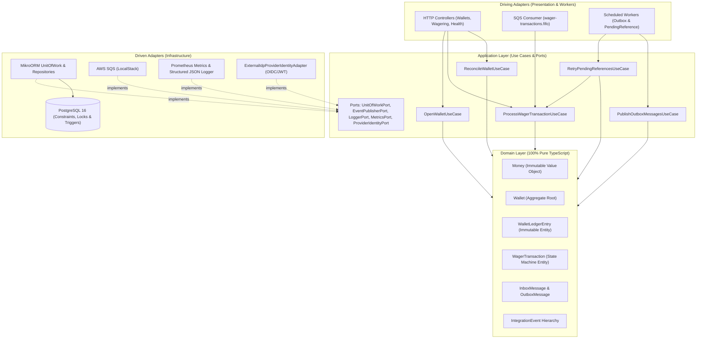

# Architecture & Engineering Decisions — Distributed Wagering Processor

Este documento detalha as decisões arquiteturais, os *Design Patterns* adotados, as garantias de banco de dados, os *trade-offs* e a análise do teste de carga do **Distributed Wagering Processor**.

---

## 1. Visão Geral da Arquitetura (DDD + Hexagonal + Event-Driven)

O sistema foi desenhado utilizando **Clean / Hexagonal Architecture (Ports & Adapters)** combinada com **Domain-Driven Design (DDD Tático)** e **Event-Driven Architecture (EDA)**.



### Por que essa divisão em camadas?
1. **`src/domain` (Domínio Puro):** Zero dependências de NestJS, MikroORM ou AWS SDK. Todas as invariantes financeiras (`Money`, `Wallet`, `WalletLedgerEntry`, `WagerTransaction`, `InboxMessage`, `OutboxMessage`, `IntegrationEvent`) residem aqui com construtores `private` e *static factories* (`create`, `open`, `from`, `rehydrate`).
2. **`src/application` (Casos de Uso):** Orquestra as unidades de trabalho transacionais (`UnitOfWorkPort`). Tanto a entrada HTTP quanto o consumidor SQS invocam exatamente o mesmo caso de uso (`ProcessWagerTransactionUseCase`).
3. **`src/infrastructure` (Adaptadores Driven):** Implementa persistência via **MikroORM** (`@mikro-orm/postgresql`), mensageria via **AWS SQS**, observabilidade via **Prometheus (`prom-client`)** + logs estruturados JSON, e autenticação via `ProviderIdentityPort`.
4. **`src/presentation` (Adaptadores Driving):** Controllers REST do NestJS e filtro global de exceções com mapeamento semântico de códigos HTTP.

---

## 2. Escolha do ORM, Mapeamento de `Money` e Estratégia Transacional

### 2.1. Por que MikroORM?
Escolhemos o **MikroORM v6 (`@mikro-orm/postgresql`)** (opção preferencial do desafio) pelos seguintes motivos:
- **Isolamento do Domínio (`EntitySchema` + `rehydrate`):** O MikroORM permite definir o schema das tabelas externamente e reconstruir as entidades de domínio através das factories estáticas `rehydrate()` sem poluir o domínio com decorators (`@Entity`, `@Property`) e sem reexecutar regras de transição de criação na leitura.
- **Controle Transacional Explícito (`fork()` + `transactional()`):** Cada operação cria um `EntityManager` isolado (`this.orm.em.fork({ clear: true })`) e executa todo o fluxo dentro de `forkedEm.transactional(async (txEm) => ...)`, garantindo atomicidade entre `wallets`, `wager_transactions`, `wallet_ledger_entries`, `inbox_messages` e `outbox_messages`.

### 2.2. Representação e Persistência de `Money`
- **Em memória (Domínio):** `Money` encapsula uma instância de `Decimal` (`decimal.js`) e o código ISO-4217 da moeda (`BRL`, `USD`, etc.). É 100% imutável (`Object.freeze(this)`).
- **Na borda (Contratos HTTP / SQS / Outbox):** Serializado e validado exclusivamente como string decimal com escala fixa de 2 casas (`/^0|[1-9]\d*\.\d{2}$/`), rejeitando `number`, `NaN`, `Infinity`, notação científica (`1e5`), strings vazias ou valores negativos.
- **No PostgreSQL:** Armazenado em colunas separadas `NUMERIC(18, 2)` e `CHAR(3)`. O tipo `NUMERIC(18, 2)` do PostgreSQL possui precisão decimal exata em base 10, eliminando qualquer risco de erro de ponto flutuante IEEE-754.

---

## 3. Concorrência, Locking e Prevenção de *Lost Updates*

### 3.1. Estratégia Adotada: Lock Pessimista por `walletId` (`SELECT ... FOR UPDATE`) + Versionamento
A unidade de concorrência do sistema é a `walletId`.

Quando `ProcessWagerTransactionUseCase` inicia uma transação SQL:
1. Adquire imediatamente um **Pessimistic Write Lock de linha** no PostgreSQL sobre a carteira alvo:
   ```sql
   SELECT id, player_id, currency, balance_amount, version, created_at, updated_at
   FROM wallets
   WHERE id = $1
   FOR UPDATE;
   ```
2. Com o lock da `walletId` adquirido, verifica a **Idempotência Persistente** (`idempotency_key` e `(provider_id, external_transaction_id)`).
3. Executa a validação de saldo e regras de negócio, atualiza `balance_amount` e incrementa `version = version + 1` (somente quando o saldo muda), insere a `WagerTransaction`, insere o `WalletLedgerEntry` e enfileira os eventos na `outbox_messages`.
4. Confirma o `COMMIT` (liberando o lock de linha).

### 3.2. Por que `SELECT ... FOR UPDATE` por `walletId` em vez de Optimistic Locking puro?
- **Determinismo em *Hot Wallets*:** No cenário obrigatório da Seção 8 (saldo inicial `100.00 BRL` e duas apostas simultâneas de `80.00 BRL`), o lock pessimista enfileira a 2ª transação no PostgreSQL por ~1–2 ms até a 1ª confirmar o débito para `20.00 BRL`. Em seguida, a 2ª transação lê o saldo atualizado (`20.00 BRL`) e é rejeitada deterministicamente com `INSUFFICIENT_FUNDS` (e auditada no banco com evento `WagerTransactionRejected`), sem precisar de loops de retry de aplicação ou falhas espúrias de versão.
- **Serialização de Replays Paralelos (Cenário de 50 apostas idênticas em paralelo):** Como todas as 50 requisições paralelas apontam para a mesma `walletId`, a 1ª adquire o lock, processa o débito e commita; as 49 seguintes adquirem o lock em sequência, encontram a transação já persistida por `idempotency_key`, validam o `payloadHash` e retornam `idempotentReplay: true` com o `observedBalance` original — zero *deadlocks* e zero erros `500`.
- **Paralelismo Total entre Jogadores:** Como o lock é a nível de linha (`WHERE id = $1`), operações em `walletId`s distintas nunca bloqueiam umas às outras.

---

## 4. Idempotência Persistente e Algoritmo de `payloadHash`

### 4.1. Algoritmo Canônico (`computeWagerPayloadHash`)
Para distinguir um **Idempotent Replay** de um **Idempotency Key Conflict**, calculamos um hash `SHA-256` sobre um JSON canônico contendo exclusivamente os campos de negócio da operação:
```json
{
  "externalTransactionId": "...",
  "gameId": "...",
  "kind": "BET",
  "money": { "amount": "25.00", "currency": "BRL" },
  "playerId": "...",
  "providerId": "...",
  "referenceExternalTransactionId": null,
  "roundId": "...",
  "walletId": "..."
}
```
As chaves são ordenadas alfabeticamente de forma recursiva (`canonicalizeJson`) e serializadas sem espaços em branco antes do cálculo do `SHA-256`. Headers HTTP, `messageId` da fila SQS e `correlationId` não entram no hash.

### 4.2. Preservação do Saldo Observado (`observed_balance_amount`)
Para cumprir a Regra 7 (*"Repetir uma operação já processada retorna o resultado original, incluindo o saldo observado naquele momento"*), a tabela `wager_transactions` armazena a coluna `observed_balance_amount NUMERIC(18, 2)`. Mesmo que a carteira sofra novas movimentações posteriormente, qualquer replay futuro de uma transação antiga retorna exatamente o saldo que a carteira possuía no instante daquela transação.

---

## 5. Garantias Aplicadas Diretamente no Schema do PostgreSQL (Seção 5.9)

Todas as invariantes financeiras críticas são protegidas no próprio SGBD (ver `Migration202610270001_InitialSchema.ts`):

1. **Não-negatividade de Saldo:**
   - `CONSTRAINT chk_wallets_balance_non_negative CHECK (balance_amount >= 0)` na tabela `wallets`.
2. **Unicidade de Carteira por Jogador e Moeda:**
   - `CONSTRAINT uq_wallets_player_currency UNIQUE (player_id, currency)` na tabela `wallets`.
3. **Idempotência e Unicidade Externa:**
   - `CONSTRAINT uq_wager_tx_idempotency_key UNIQUE (idempotency_key)`
   - `CONSTRAINT uq_wager_tx_provider_external UNIQUE (provider_id, external_transaction_id)`
4. **Proibição de Reversão Dupla no Banco (Partial Unique Index):**
   - `CREATE UNIQUE INDEX uq_wager_tx_single_processed_reversal ON wager_transactions (reference_transaction_id) WHERE status = 'PROCESSED' AND kind IN ('REFUND', 'ROLLBACK');`
   - Garante que uma mesma transação referenciada jamais tenha mais de uma reversão efetivada (`PROCESSED`).
5. **Equação Contábil do Ledger Verificada pelo PostgreSQL:**
   - `CONSTRAINT uq_ledger_single_entry_per_tx UNIQUE (transaction_id)` (no máximo 1 lançamento por transação).
   - `CONSTRAINT chk_ledger_arithmetic_balanced CHECK ((direction = 'CREDIT' AND balance_after = balance_before + amount) OR (direction = 'DEBIT' AND balance_after = balance_before - amount))`
6. **Imutabilidade Estrita (Append-Only) do Ledger via Trigger PL/pgSQL:**
   - A trigger `trg_prevent_wallet_ledger_mutation` (`BEFORE UPDATE OR DELETE ON wallet_ledger_entries`) bloqueia qualquer tentativa de `UPDATE` ou `DELETE` diretamente no PostgreSQL.

---

## 6. Transactional Inbox, Transactional Outbox e Referências Fora de Ordem

### 6.1. Transactional Inbox (SQS Consumer)
- Quando uma mensagem chega via `wager-transactions.fifo`, o consumidor registra `(consumer_name, message_id)` na tabela `inbox_messages` **dentro da mesma transação SQL** que altera a carteira e grava o ledger e a outbox.
- O `ACK` (`DeleteMessageCommand`) no SQS só é enviado **após o `COMMIT` da transação SQL**.
- Se o worker morrer após o `COMMIT` e antes do `ACK`, a mensagem será reentregue pelo SQS para outra instância, que identificará o registro na `inbox_messages` (e a `idempotency_key`) e fará o `ACK` imediatamente sem duplicar efeitos.

### 6.2. Transactional Outbox com Múltiplos Publishers (`FOR UPDATE SKIP LOCKED`)
- Os eventos de integração (`WagerTransactionProcessed`, `WagerTransactionRejected`, `WalletBalanceChanged`, `WagerTransactionPendingReference`) herdam da classe abstrata `IntegrationEvent<T>` e são gravados na tabela `outbox_messages` na mesma transação SQL.
- O worker `PublishOutboxMessagesUseCase` busca lotes de eventos pendentes usando:
  ```sql
  SELECT ... FROM outbox_messages
  WHERE published_at IS NULL AND (next_attempt_at IS NULL OR next_attempt_at <= NOW())
  ORDER BY next_attempt_at ASC NULLS FIRST, occurred_at ASC
  LIMIT 50
  FOR UPDATE SKIP LOCKED;
  ```
- Isso permite que 3 ou mais instâncias publiquem eventos em paralelo sem bloqueio mútuo e sem duplicação. Em caso de falha no broker, `scheduleRetry(now)` aplica backoff exponencial (`1s, 2s, 4s, ..., 60s`).

### 6.3. Referências Fora de Ordem (`PENDING_REFERENCE`)
- Se um `REFUND` ou `ROLLBACK` chegar antes da transação referenciada (`BET`/`WIN`), a transação é persistida com status `PENDING_REFERENCE` (retornando HTTP `202 Accepted` e publicando `WagerTransactionPendingReference`).
- O worker agendado `RetryPendingReferencesUseCase` seleciona registros vencidos via `FOR UPDATE SKIP LOCKED` com backoff exponencial (`1s, 2s, 4s, 8s, 16s`, limite de `5` tentativas).
- Se a referência chegar dentro da janela, a reversão é processada normalmente. Caso esgote as 5 tentativas, a transação transiciona para `REJECTED` com `failureCode = REFERENCE_NOT_FOUND_TIMEOUT` e emite `WagerTransactionRejected`.

---

## 7. Autenticação (Seção 2 — Decisão e Ponto de Extensão)

Conforme orientado na Seção 2 do desafio, deixamos o ponto de extensão explícito no código através da porta `ProviderIdentityPort` (`src/application/ports/observability.port.ts`) e do adaptador `ExternalIdpProviderIdentityAdapter` + `ProviderAuthGuard` (`src/infrastructure/auth/provider-auth.guard.ts`):
- **Desenho para Produção (Keycloak / Zitadel OIDC):** Cada provedor de jogos autentica-se via *OAuth 2.0 Client Credentials Grant* junto ao IdP externo (Keycloak ou Zitadel), recebendo um Access Token JWT assinado (RS256/EdDSA) contendo as claims `iss`, `sub`, `azp`/`provider_id` e `scope: "wagering:write wagering:read"`.
- O `ProviderAuthGuard` protege todos os endpoints de `/wallets` e `/wagering`, enquanto `/health/live`, `/health/ready` e `/metrics` permanecem abertos.
- O modo é controlado por `AUTH_MODE=permissive` (padrão local/testes para não exigir container de IdP) ou `AUTH_MODE=oidc` (exige Bearer JWT válido com verificação de `exp` e `OIDC_ISSUER_URL`).

---

## 8. Relatório do Teste de Carga (`bun run test:load`)

Executamos o experimento de carga automatizado (`test/load/load-test.ts`) com **3 instâncias simultâneas** da aplicação:

### 8.1. Ambiente de Execução
- **SO / Hardware:** Windows 11 x64 (`10.0.26300`), 13th Gen Intel Core i5-13420H (12 threads), 23.7 GB RAM
- **Runtime:** Bun `1.4.4`
- **Topologia:** 3 instâncias NestJS independentes (`app-1`, `app-2`, `app-3`) compartilhando o mesmo banco PostgreSQL 16 e fila SQS.

### 8.2. Metodologia
O teste executa **300 transações financeiras** divididas em duas fases:
1. **Fase A (Paralelismo Multi-Wallet + Idempotência):** 20 carteiras distintas recebendo 160 operações concorrentes (`BET`, `WIN`, `LOSS`) em ondas de 25 requisições paralelas + 40 disparos simultâneos de uma mesma aposta (testando deduplicação sob carga).
2. **Fase B (Contenção Extrema em *Hot Wallet*):** 1 única carteira com saldo de `1000.00 BRL` recebendo **100 apostas simultâneas de `20.00 BRL`** distribuídas entre as 3 instâncias (onde exatamente 50 devem ser `PROCESSED` e 50 `REJECTED` com `INSUFFICIENT_FUNDS`).

### 8.3. Resultados Obtidos

| Métrica | Valor Observado |
|---|---|
| **Total de Transações Submetidas** | `300` |
| **Duração Total** | `1.726 s` |
| **Throughput Médio** | **`173.78 req/s`** |
| **Latência p50 (Mediana)** | `109.17 ms` |
| **Latência p95** | `543.37 ms` |
| **Latência p99** | `591.04 ms` |
| **Taxa de Erro Inesperado (HTTP 5xx)** | **`0.00%`** (`0` falhas) |
| **Resultados de Negócio** | `211 PROCESSED`, `50 REJECTED (INSUFFICIENT_FUNDS)`, `39 Idempotent Replays` |
| **Eventos Gerados e Publicados na Outbox** | `496` eventos drenados pelos 3 workers concorrentes em `1.15 s` |
| **Invariante Final (`wallet.balance == ledger`)** | **`21/21` carteiras 100% consistentes** (`214` lançamentos auditados, diferença `0.00 BRL`) |

### 8.4. Análise Crítica dos Resultados
- Na **Fase A (carteiras distintas)**, a latência mediana permaneceu baixa (`~109 ms`) pois os locks pessimistas por `walletId` não competem entre si.
- Na **Fase B (100 requisições simultâneas na mesma *hot wallet*)**, a fila de lock de linha (`SELECT ... FOR UPDATE`) elevou o `p95`/`p99` para `~543–591 ms` (tempo necessário para serializar 100 transações ACID na mesma linha), mas garantiu **zero falsos positivos, zero *deadlocks* e precisão matemática absoluta** (exatamente 50 apostas aprovadas zerando o saldo de `1000.00 BRL` e 50 rejeitadas por falta de saldo).

---

## 9. Trade-offs Conhecidos, Limitações e Evolução para Produção

Para manter a simplicidade e o foco nas invariantes avaliadas, adotamos alguns *trade-offs* conscientes que em um ambiente real de altíssima escala (100k+ RPS) evoluiriam da seguinte forma:

1. **Reconciliação em Memória vs. Agregação/Streaming SQL:**
   - *Como está hoje:* `ReconcileWalletUseCase` carrega a lista ordenada de lançamentos da carteira para verificar em código tanto a soma algébrica quanto o encadeamento `balanceBefore -> balanceAfter` de cada linha.
   - *Evolução para produção:* Para carteiras com milhões de lançamentos históricos, executar a soma via agregação SQL (`SUM(CASE WHEN direction='CREDIT' THEN amount ELSE -amount END)`) + verificação incremental baseada em *snapshots* periódicos de saldo.
2. **Publicação da Outbox dentro do Lock (`FOR UPDATE SKIP LOCKED`):**
   - *Como está hoje:* `PublishOutboxMessagesUseCase` publica cada mensagem no SQS dentro da transação que detém o `FOR UPDATE SKIP LOCKED`.
   - *Evolução para produção:* Adotar um padrão *Claim Check* em duas fases curtas (`UPDATE outbox_messages SET locked_until = NOW() + INTERVAL '30s'`) e enviar lotes de 10 mensagens via `SendMessageBatchCommand` do SQS fora da transação SQL, além de definir um limite máximo de tentativas (`MAX_OUTBOX_ATTEMPTS`) para mover falhas permanentes de serialização para uma tabela `outbox_dead_letters`.
3. **Retenção e Particionamento de `inbox_messages` e `outbox_messages`:**
   - *Como está hoje:* As tabelas mantêm todo o histórico indefinidamente.
   - *Evolução para produção:* Particionamento nativo do PostgreSQL (`PARTITION BY RANGE (occurred_at)`) com descarte (`DROP PARTITION`) de partições antigas já publicadas/processadas após a janela de retenção operacional (ex.: 14 dias).
4. **Validação Criptográfica JWKS e Autorização por `providerId`:**
   - *Como está hoje:* `ExternalIdpProviderIdentityAdapter` opera em modo `permissive` por padrão para testes locais e decodifica claims OIDC.
   - *Evolução para produção:* Validação criptográfica da assinatura JWT (RS256/EdDSA) via endpoint JWKS (`/.well-known/jwks.json`) do Keycloak/Zitadel com cache de chaves públicas e verificação estrita de que `token.provider_id === payload.providerId` (prevenção de BOLA/IDOR).

